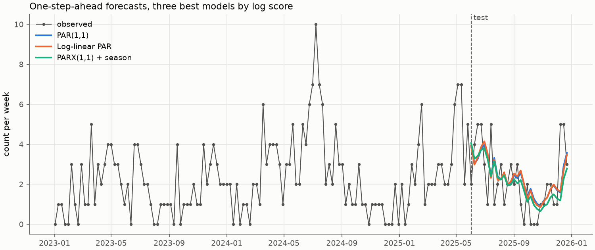
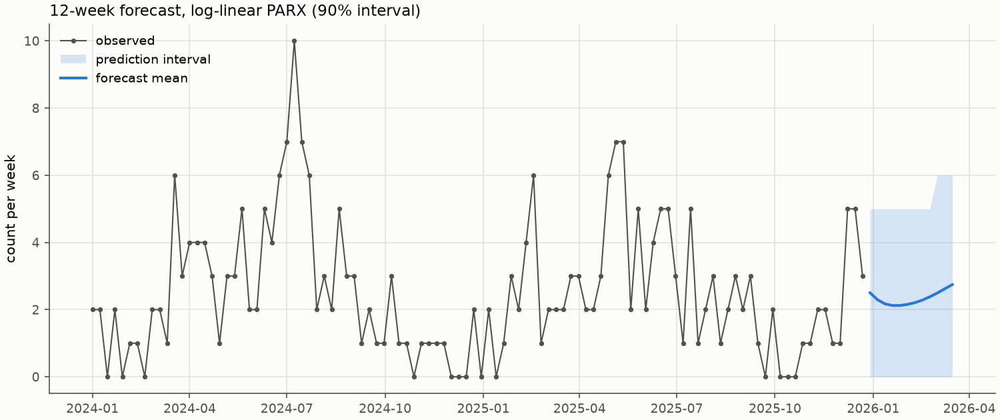

# piracy-par

Poisson autoregressions for weekly counts of maritime piracy incidents, and a scraper that
turns the ICC-CCS / IMB live piracy map into a weekly count series.

The repository contains **no real piracy data**. The bundled series is synthetic (see
[Data](#data)), so the results below show what the code does. They say nothing about piracy.

## The problem

Reported piracy incidents per week are small counts (mean about 2 to 3) with serial
dependence: busy weeks tend to follow busy weeks. Gaussian ARMA models are a poor fit for
such data. The package implements the standard observation-driven count models for this
setting, fits them by exact maximum likelihood, and compares their one-step-ahead forecasts
using proper scoring rules.

## Models

Every model assumes $y_t \mid \mathcal{F}_{t-1} \sim \text{Poisson}(\lambda_t)$. The models
differ in how the intensity $\lambda_t$ depends on the past. Covariates $x_t$ enter the
intensity of $y_t$, so they must be known at time $t-1$, for example deterministic
seasonality or lagged covariates.

**Linear PAR(p, q) / PARX**: `PAR`, `PARX` (INGARCH; Ferland, Latour & Oraichi 2006;
Fokianos, Rahbek & Tjøstheim 2009; covariates as in Agosto et al. 2016)

$$\lambda_t = \omega + \sum_{i=1}^{p} \alpha_i\, y_{t-i} + \sum_{j=1}^{q} \beta_j\, \lambda_{t-j} + \gamma^\top x_t$$

The parameter constraints are $\omega > 0$ and $\alpha_i, \beta_j, \gamma_k \ge 0$, plus
$\sum_i \alpha_i + \sum_j \beta_j < 1$, which gives a second-order stationary process.
Covariates must be non-negative, which keeps $\lambda_t > 0$. For seasonality,
`seasonal_features(dates, nonnegative=True)` returns four half-wave rectified columns:
$\max(\pm\sin, 0)$ and $\max(\pm\cos, 0)$ of the annual angle. With $\gamma \ge 0$ these
columns can put the seasonal peak at any time of year. They approximate a sinusoid but
cannot reproduce one exactly. A shifted pair $1+\sin$, $1+\cos$ would confine the peak to
the first quarter of the year.

**Log-linear PAR / PARX**: `LogLinearPAR`, `LogLinearPARX` (Fokianos & Tjøstheim 2011)

$$\nu_t = \log\lambda_t = d + a\,\nu_{t-1} + b\,\log(1 + y_{t-1}) + c^\top x_t$$

Coefficients may be negative, and the intensity is positive by construction. By default the
fit is constrained to $\max(|a|, |b|, |a+b|) < 1$. Under this condition Douc, Doukhan &
Moulines (2013, Prop. 17) show that the process is stationary and ergodic. The condition is
weaker than $|a| + |b| < 1$ when $a$ and $b$ have opposite signs. `LogLinearPAR(stationarity=False)`
imposes only $|a| < 1$. That keeps the $\nu$ recursion from exploding but does not guarantee
a stationary process.

**Poisson GLM baseline**: `PoissonGLM(lags)`

$$\log\lambda_t = \text{const} + \sum_{k=1}^{\text{lags}} \phi_k \log(1 + y_{t-k}) + \beta^\top x_t$$

`PoissonGLM(lags=0)` without covariates is the naive constant-mean forecast. With lags it is
a Zeger-Qaqish style GLM, which is the log-linear model with $a = 0$.

### Estimation

- **Likelihood:** exact conditional maximum likelihood, with the $-\log y_t!$ term included.
  The likelihood conditions on the first $m$ observations: $m = \max(p, q)$ for the linear
  model, $m = 1$ for the log-linear model and $m$ = `lags` for the GLM. Pre-sample
  intensities are fixed at the training mean $\bar y$.
- **Linear and log-linear models:** fitted with SLSQP using analytic gradients from the score
  recursion. The optimiser is run from several starting values and the best fit is kept:
  - linear model: an OLS start plus a small grid of persistence levels;
  - log-linear model: a Poisson GLM start (as in Fokianos & Tjøstheim) plus starts with
    $a \in \{0.3, 0.5, 0.7, 0.9, -0.5\}$.
- **GLM:** fitted by damped Newton-Raphson. It reports `converged_ = False` (with a warning)
  when the MLE does not exist, for example when a covariate separates the zero counts.
- **Standard errors:** from a finite-difference Hessian of the analytic gradient. Differences
  are one-sided next to a bound. `coef_table()` flags parameters that sit on a bound or in an
  active stationarity constraint (`at_bound`). Their standard errors are not valid.

### API

Every model has:

- `fit(y, X=None)`, `loglik(params)`, `score(params)` and `fitted_values()`;
- `predict(y_new, X_new)`: rolling one-step intensities after the training sample;
- `forecast(h, X_future)`: an h-step mean plus a simulated prediction interval. The mean is
  exact for the linear model and for the GLM without lags. Otherwise it is a Monte Carlo
  mean;
- `simulate(n)`;
- `params`, `coef_table()` and `summary()`.

| Module | Contents |
|---|---|
| `piracy_par.models` | the models above, `poisson_loglik`, `fit_poisson_glm` |
| `piracy_par.evaluation` | log score, Dawid-Sebastiani score, ranked probability score, MAE/RMSE, randomised PIT, time-ordered split, `compare_models` |
| `piracy_par.plots` | one-step forecast, multi-step fan and residual diagnostic figures (matplotlib `Figure`, works headless) |
| `piracy_par.data.imb_parser` | browser-free parser for map entries: place repair and keyword heuristics for incident and vessel type |
| `piracy_par.data.imb_scraper` | Selenium fetcher and the `piracy-par-scrape` CLI (`fetch`, `parse`, `weekly`) |
| `piracy_par.data.weekly` | weekly aggregation, seasonal features, CSV loader |
| `piracy_par.data.sample` | synthetic sample generator and the bundled `synthetic_weekly_counts.csv` |

## Data

### Bundled sample (synthetic)

`src/piracy_par/data/synthetic_weekly_counts.csv` holds 156 weeks (2023-01-02 to
2025-12-22, mean 2.29, variance 3.40). It is simulated from a log-linear PARX with annual
sin/cos terms, $(d, a, b, c_{\sin}, c_{\cos}) = (0.11, 0.45, 0.30, 0.15, -0.10)$. Its mean
and spread were chosen to resemble a real weekly series of IMB-reported incidents. The file
labels itself as synthetic in its first line. `python -m piracy_par.data.sample`
regenerates it exactly.

### Building a real series: scraper to weekly counts

The ICC-CCS map pages render the incident table with JavaScript, so fetching needs a
browser: the optional `scrape` extra (Selenium) and Chrome or Chromium. Parsing and
aggregation work without a browser.

```bash
uv sync --extra scrape
uv run piracy-par-scrape fetch --years 2023 2024 2025 --out scrape_out
uv run piracy-par-scrape weekly --incidents scrape_out/all_incidents.csv --out weekly_counts.csv
uv run python examples/fit_and_forecast.py --data weekly_counts.csv
```

1. **`fetch`** checks robots.txt, loads each year's map page, shows all table rows and saves
   the raw details text (`raw_data_{year}.csv`).
   - It waits at least 2 s between pages and sends its own user agent.
   - It retries failed pages with backoff.
   - It exits with status 1 if Selenium is missing or no year could be fetched.
2. **Parsing** splits each entry into date, time, coordinates, place and narration. It
   converts coordinates to decimal degrees, repairs glued place names, and adds keyword-based
   `incident_type` and `vessel_type_inferred` labels. Lines that do not parse go to
   `failed_lines.csv`. `piracy-par-scrape parse --raw ...` re-runs this step offline on the
   saved raw files.
3. **`weekly`** removes duplicate incidents (same date, time, coordinates, place and
   narration) and counts incidents per week. Weeks run Tuesday to Monday, are labelled by the
   closing Monday (`W-MON`), and weeks with no incidents count as 0. `--by-type` adds one
   count column per incident type.

The scraper output is copyrighted (see [Limitations](#limitations)). `.gitignore` keeps the
scraper's output files out of the repository.

## Results on the synthetic sample

`examples/fit_and_forecast.py` fits each model on the first 126 weeks and scores rolling
one-step forecasts on the last 30 weeks. All scores are averages over the test weeks, and
lower is better. Seasonal models use the annual sin/cos features; the linear PARX uses their
non-negative rectified form.

| Model | Parameters | Log score | Dawid-Sebastiani | RPS | MAE | RMSE |
|---|---:|---:|---:|---:|---:|---:|
| PAR(1,1) | 3 | 1.709 | 1.715 | 0.795 | 1.204 | 1.456 |
| Log-linear PAR | 3 | 1.711 | 1.714 | 0.801 | 1.208 | 1.468 |
| PARX(1,1) + season | 7 | 1.712 | 1.762 | 0.788 | 1.160 | 1.451 |
| Log-linear PARX + season | 5 | 1.726 | 1.786 | 0.804 | 1.178 | 1.486 |
| Poisson GLM, 1 lag + season | 4 | 1.747 | 1.859 | 0.818 | 1.192 | 1.513 |
| Naive mean (Poisson) | 1 | 1.833 | 1.951 | 0.903 | 1.351 | 1.604 |

Every autoregressive model beats the naive constant mean on every score. The four
PAR-type models are within 0.02 of each other in log score, and with only 30 test weeks
that difference is noise. The ranking does not show that one model is better.

The data were generated by the log-linear PARX, yet it ranks fourth on these 30 weeks. Fitted
on the training block, it gives $\hat d = -0.02$ (SE 0.11), $\hat a = 0.47$ (0.14),
$\hat b = 0.39$ (0.11), $\hat c_{\sin} = 0.12$ (0.05) and $\hat c_{\cos} = -0.10$ (0.08). All
five estimates are within 1.3 standard errors of the generating values.





The script also writes a residual diagnostic figure for the best model
([docs/figures/diagnostics.png](docs/figures/diagnostics.png)): Pearson residuals,
their autocorrelation, and a randomised PIT histogram. It also writes `metrics.csv` and
`forecast.csv`. The run is seeded, and repeated runs produce identical files.

## How to run

You need [uv](https://docs.astral.sh/uv/) and Python 3.11 or newer.

```bash
uv sync                                               # package + dev tools (pytest, ruff), from uv.lock
uv run pytest                                         # test suite
uv run ruff check . && uv run ruff format --check .   # lint and format check
uv run python examples/fit_and_forecast.py --out outputs
```

The example prints the metrics table, coefficient tables for two models, and the 12-week
forecast. It writes its CSV files and three PNG figures to `--out`. `--data`, `--date-col`,
`--count-col`, `--test-size` and `--horizon` point it at your own weekly CSV.

With pip instead of uv:

```bash
python -m venv .venv && . .venv/bin/activate
pip install -e ".[test]"        # adds pytest; or, with pip >= 25.1: pip install -e . --group dev
pytest
```

Minimal use:

```python
from piracy_par import LogLinearPARX
from piracy_par.data import load_sample, seasonal_features

y = load_sample()
X = seasonal_features(y.index)
model = LogLinearPARX().fit(y, X)
print(model.summary())
```

## Tests

The suite in `tests/` runs in a few seconds. A fixture blocks network access during tests.
It covers:

- **Likelihood:** for each model, the log-likelihood equals a sum of
  `scipy.stats.poisson.logpmf` over intensities from separately written loop recursions.
- **Gradient:** the analytic score matches finite differences.
- **Fitting:**
  - parameter recovery on 3000 simulated observations for PAR, PARX and log-linear PARX,
    including a negative coefficient;
  - the GLM agrees with a generic BFGS fit;
  - KKT conditions hold at the optimum.
- **Constraints and inputs:**
  - the stationarity constraints hold;
  - opposite-sign log-linear coefficients are not pulled to a boundary;
  - `at_bound` flags an active constraint;
  - the GLM reports separation;
  - the Hessian stays inside the bounds;
  - sparse data reach the best known optimum;
  - invalid inputs are rejected.
- **Forecasting:**
  - `predict` matches the full-series recursion;
  - the linear mean forecast converges to $\omega / (1 - \sum\alpha - \sum\beta)$;
  - output shapes are correct and simulation is reproducible.
- **Scores:** checked against scipy and a brute-force RPS.
- **Scraper:**
  - the parser on invented, hand-written HTML fixtures;
  - a full scrape run with a fake browser;
  - the CLI exit codes;
  - importing the scraper does not load Selenium.

CI (`.github/workflows/ci.yml`) runs ruff and the tests on Python 3.11, 3.12 and 3.13 with
`uv sync --locked`, then runs the example.

## Limitations

- **Real data and licensing:**
  - All results here are on synthetic counts. Results on real data cannot be reproduced
    from this repository.
  - IMB narrations and coordinates are copyrighted by ICC Commercial Crime Services. Their
    terms prohibit reproduction except as their copyright notice allows. There is no
    redistribution licence, so no scraped data is included.
  - Whether even aggregate weekly counts derived from the map may be published is not
    settled; database rights may apply. Check the ICC-CCS terms before scraping, and do not
    redistribute the output.
- **Scraper:**
  - The page URLs and table ids were observed in 2025 and may change.
  - Incident and vessel types are keyword heuristics on the narration text, not IMB's own
    classification.
- **Linear PARX:**
  - It keeps $\gamma \ge 0$ with non-negative covariates, so covariates can only raise the
    intensity.
  - The rectified seasonal basis approximates a sinusoidal pattern rather than reproducing it.
  - The log-linear PARX allows signed effects.
- **Standard errors:** they are not valid for parameters on a bound or in an active
  stationarity constraint, which are flagged `at_bound`. The constraints are enforced with a
  small margin ($\le 1 - 10^{-4}$).
- **Log-linear fits:** the pre-sample intensity is fixed at the sample mean. On data with
  little dependence, a log-linear fit can therefore run to $a \approx 1$, which mimics a
  constant intensity; `at_bound` flags this. Model comparison should rely on out-of-sample
  scores, as `compare_models` does. Its table has no in-sample log-likelihood or AIC because
  each model conditions on a different number of initial observations.
- **Python versions:** the tests have been run locally on Python 3.12 to 3.14. Python 3.11
  is covered only by CI.

## References

- Agosto, A., Cavaliere, G., Kristensen, D. & Rahbek, A. (2016). Modeling corporate defaults:
  Poisson autoregressions with exogenous covariates (PARX). *Journal of Empirical Finance* 38.
- Douc, R., Doukhan, P. & Moulines, E. (2013). Ergodicity of observation-driven time series
  models and consistency of the maximum likelihood estimator. *Stochastic Processes and their
  Applications* 123(7). arXiv:1210.4739.
- Ferland, R., Latour, A. & Oraichi, D. (2006). Integer-valued GARCH process. *Journal of
  Time Series Analysis* 27(6).
- Fokianos, K., Rahbek, A. & Tjøstheim, D. (2009). Poisson autoregression. *Journal of the
  American Statistical Association* 104(488).
- Fokianos, K. & Tjøstheim, D. (2011). Log-linear Poisson autoregression. *Journal of
  Multivariate Analysis* 102(3).

## License

MIT, see [LICENSE](LICENSE). This covers the code only. It grants no rights to IMB / ICC-CCS
data.
